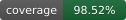
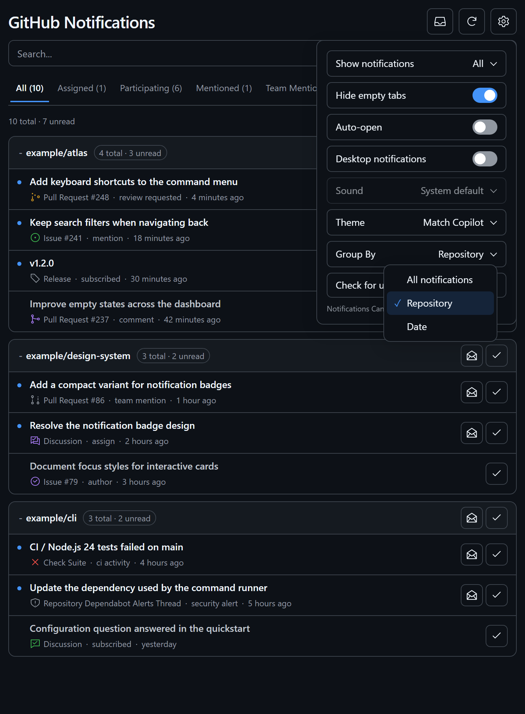

# GitHub Notifications

[](#prerequisites)
[](https://github.com/fletchto99/copilot-notifications-canvas/releases/latest)
[](https://github.com/fletchto99/copilot-notifications-canvas/actions/workflows/tests.yml)
[](https://github.com/fletchto99/copilot-notifications-canvas/actions/workflows/tests.yml)
[](#prerequisites)

Your GitHub inbox in the GitHub Copilot app, grouped by repository or date, or
shown as a single newest-first list. **Show notifications** defaults to **All**,
showing read and unread inbox items; choose **Unread only** to narrow the view. Completed items
stay hidden in both views. Search, mark rows
or groups as read or done, and opt into desktop notifications or auto-open.



## Prerequisites

- A GitHub Copilot app build with extension canvas support (experimental).
- Node.js 22 or later for the extension runtime and installer.
- [GitHub CLI](https://cli.github.com/) (`gh`) available to the app and signed
  into **github.com** with `notifications` or `repo` scope.

GitHub.com only; fine-grained personal access tokens are not supported.
See the [installation guide](docs/installation.md#prerequisites) for CLI
verification requirements and the sign-in check.

[Development tooling](docs/development.md#local-development) requires Node.js 24
or later; this does not change the packaged extension's runtime requirement.

<a id="installation"></a>
<a id="updating"></a>

## Installation and Updating

Paste this prompt into Copilot:

```text
Install or update the GitHub Notifications canvas as a user-wide Copilot
extension using the latest stable release from:
https://github.com/fletchto99/copilot-notifications-canvas

Follow docs/installation.md in that repository, including all verification
and settings-preservation requirements. Stop if any check fails.
After installation succeeds, reload extensions and open the canvas.
```

[Manual installation and updates](docs/installation.md) cover the
full procedure, verification requirements, and troubleshooting.

## Usage

- Filter with the attention tabs or search by title, issue/PR number, or repository.
- Choose **All notifications**, **Repository**, or **Date** in **Settings**.
- Set **Show notifications** in **Settings** to **All** for read and unread inbox
  items, or **Unread only** to narrow the view.
- Icons show issue/PR states, including merge queue membership, and check-suite
  results. Screen-reader descriptions include status, freshness, and failures;
  icons have no hover tooltips. Status loads for on-screen, expanded rows
  without delaying the inbox.
- Check-suite rows open resolved or conservatively matched runs, or the sole
  failed job's logs. Unresolved rows fall back to filtered Actions when possible,
  or the repository Actions page otherwise.
- Use the envelope to mark a row **read**, or the checkmark to mark it **done**.
  Each group header offers the same bulk actions.
- Use **Load more** for older notifications. Search, counts, and bulk actions
  cover **loaded items only**, not your entire GitHub inbox.

See the [usage guide](docs/usage.md) for filtering, bulk actions, keyboard
controls, and refresh behavior. [Settings](docs/settings.md) covers saved
preferences and opt-in desktop alerts.

## Privacy

The extension does not log notification titles or repository names, save them to
disk, or send them to the agent. There is no telemetry or remote asset loading.

**Desktop alerts send repository names and titles to your OS**, which may retain
them in notification history or show them on the lock screen. System settings
control this, not the extension.

The local `artifacts/` directory stores settings and desktop coordination data:
timestamps, hashed activity/thread IDs, watcher/process markers and sanitized
errors. GitHub CLI handles credentials; they never enter the canvas renderer.

GitHub CLI fetches notifications, the status of loaded issues, pull requests and
check suites, merge queue membership, bounded workflow-run matches for missing
links, and public release metadata. Inferred run links are identified in
screen-reader descriptions and fall back
to filtered Actions when matching is inconclusive. Failed runs open the job log
viewer when exactly one job failed; the extension reads job metadata, not logs.
Status is
cached only in memory. Update checks do
not send notification content or download or execute release code. Only explicit
**Mark as read** or **Mark as done** actions send notification updates; visiting a
linked GitHub page may also mark a notification read on GitHub.

## Documentation

- [Usage](docs/usage.md): browsing, filtering, Read/Done actions, and keyboard controls.
- [Installation](docs/installation.md): setup, updates, and verification.
- [Settings](docs/settings.md): preferences, desktop alerts, and troubleshooting.
- [Development](docs/development.md): local development, tests, packaging, and releases.
- [Agent guidance](AGENTS.md): repository conventions, invariants, and validation.
